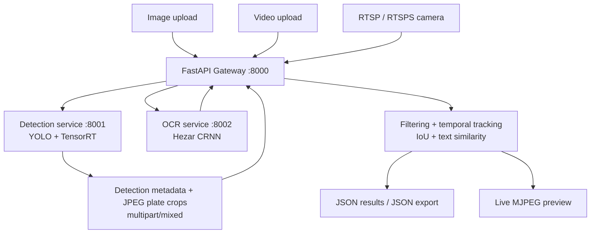

# ALPR-Persian

### A Dockerized Iranian License Plate Detection and Recognition Pipeline

[](https://www.python.org/)
[](https://fastapi.tiangolo.com/)
[](https://www.docker.com/)
[](https://www.ultralytics.com/)
[](https://github.com/mehdinmz/ALPR-Persian)
[](https://github.com/mehdinmz/ALPR-Persian)

ALPR-Persian is a Dockerized automatic license plate recognition system
for Iranian vehicles. It combines YOLO-based plate detection, CRNN-based
Persian OCR, and temporal tracking behind a FastAPI gateway, accepting
images, recorded videos, and live RTSP/RTSPS streams.

> **Reliability principle:** the gateway rejects detections that do not
> meet its configured plate-length and detection-confidence checks
> rather than treating every OCR prediction as a confirmed plate. These
> checks reduce some invalid outputs; they do not guarantee that every
> accepted plate is correct.

## Contents

-   [Overview](#overview)
-   [Features](#features)
-   [Architecture](#architecture)
-   [Repository Structure](#repository-structure)
-   [Requirements](#requirements)
-   [Quick Start](#quick-start)
-   [API Reference](#api-reference)
-   [Configuration](#configuration)
-   [Performance and Evaluation](#performance-and-evaluation)
-   [Limitations](#limitations)
-   [Roadmap](#roadmap)
-   [Contributing](#contributing)
-   [License](#license)
-   [Contact](#contact)

## Overview

The project targets vehicle-entry workflows, including fuel-station
access, where a vehicle needs to be identified within a short decision
window. The intended decision time is approximately **3--4 seconds per
vehicle**; this is a target and has not been published as a measured
benchmark.

The gateway processes images directly or manages video and live camera
streams. For each frame, it requests plate detections and crops from the
detection service, sends each crop to the OCR service, filters candidate
results, tracks observations across frames, and exposes results through
JSON and a live MJPEG view.

## Features

-   **Iranian plate OCR:** uses a locally stored CRNN model through
    Hezar.
-   **YOLO plate detection:** detects and crops license plates.
-   **Multiple input types:** still images, uploaded video files, and
    RTSP/RTSPS streams.
-   **Temporal tracking:** uses bounding-box Intersection over Union
    (IoU) and text similarity to associate observations.
-   **Conservative filtering:** the gateway drops image detections
    unless the recognized text has length 8 and the detector confidence
    meets the configured minimum.
-   **JSON export:** exports per-stream summaries and unique plate
    records.
-   **Live preview:** provides an MJPEG endpoint for a stream.
-   **Persian annotations:** uses Vazirmatn, `arabic_reshaper`, and
    `python-bidi` to render Persian text in the dashboard/video
    annotations.
-   **Separated services:** detection, OCR, and gateway run as separate
    Docker containers.
-   **GPU detection inference:** the detection container uses CUDA and
    TensorRT, and can export a TensorRT engine from the included `.pt`
    model when the engine is missing.

## Architecture



### Services

  ---------------------------------------------------------------------------------
  Service          Container image                   Internal port Responsibility
  ---------------- ------------------------- --------------------- ----------------
  Gateway          `alpr-gateway:latest`                    `8000` Public API,
                                                                   stream
                                                                   lifecycle, OCR
                                                                   orchestration,
                                                                   tracking,
                                                                   annotations,
                                                                   JSON export,
                                                                   dashboard

  Detection        `alpr-detection:latest`                  `8001` YOLO detection,
                                                                   tracking within
                                                                   the detection
                                                                   service, plate
                                                                   cropping,
                                                                   multipart
                                                                   response

  OCR              `alpr-ocr:latest`                        `8002` CRNN inference
                                                                   through Hezar
  ---------------------------------------------------------------------------------

Only the gateway port is published to the host by the supplied
`docker-compose.yml`. The detection and OCR ports are exposed to the
Docker network and are reached by the gateway using the service names
`detection` and `ocr`.

## Repository Structure

``` text
ALPR-Persian/
├── main.py
├── Dockerfile
├── requirements.txt
├── docker-compose.yml
├── template/
│   └── index.html
├── detection/
│   ├── main.py
│   ├── Dockerfile
│   ├── Models/
│   │   └── license_plate_detector_s.pt
│   └── Scripts/
│       └── exporting_to_trt.py
└── ocr/
    ├── main.py
    ├── Dockerfile
    ├── requirements.txt
    └── Models/
        └── crnn-fa-license-plate-recognition-v2/
```

The OCR model directory contains the model and preprocessor files
expected by Hezar. Keep the complete model directory in the build
context. The detection image expects the `.pt` weights and export script
to be present.

## Requirements

-   Git
-   Docker Engine or Docker Desktop with Docker Compose
-   An NVIDIA GPU supported by the selected CUDA/TensorRT stack for
    detection
-   NVIDIA Container Toolkit when running Linux containers with GPU
    access
-   Enough disk space to build the CUDA, PyTorch, ONNX, and TensorRT
    dependencies and store model artifacts

The detection Dockerfile uses a CUDA 12.8 base image, PyTorch CUDA 12.8
packages, and TensorRT. The OCR Dockerfile installs CPU-only PyTorch.
The gateway uses Python 3.12; the OCR image uses Python 3.11.

**Important:** the detection service exports its TensorRT engine at
startup if `Models/license_plate_detector_s.engine` is absent. This
export requires a CUDA-capable GPU and may take several minutes.
TensorRT engines are environment-dependent; validate the generated
engine on the intended deployment machine.

## Quick Start

Run these commands from the repository root.

### 1. Clone the repository

``` bash
git clone https://github.com/mehdinmz/ALPR-Persian.git
cd ALPR-Persian
```

### 2. Build the three images

The Compose file refers to prebuilt images and does not define `build:`
contexts, so build each image explicitly:

``` bash
docker build -t alpr-detection:latest ./detection
docker build -t alpr-ocr:latest ./ocr
docker build -t alpr-gateway:latest .
```

### 3. Start the services

``` bash
docker compose up -d
docker compose ps
docker compose logs --tail=100
```

The first detection-service startup may export the TensorRT engine.
Check its logs if the service does not become available:

``` bash
docker compose logs -f detection
```

### 4. Open the dashboard and check health

-   Dashboard: `http://localhost:8000/`
-   Gateway health: `http://localhost:8000/health`

``` bash
curl http://localhost:8000/health
```

The gateway health response contains `status`, `active_streams`, and
`total_streams`. The detection and OCR services also define `/health`
endpoints, but their ports are not published to the host by the default
Compose file.

### 5. Stop the services

``` bash
docker compose down
```

## API Reference

The examples below match the endpoint paths and request fields in the
current source code. The application does not define a separate
versioned API prefix.

### Gateway endpoints

  ----------------------------------------------------------------------------------
  Method                  Endpoint                           Purpose
  ----------------------- ---------------------------------- -----------------------
  `GET`                   `/`                                Serves
                                                             `template/index.html`
                                                             when present

  `GET`                   `/health`                          Gateway status and
                                                             stream counts

  `POST`                  `/process/image`                   Process one uploaded
                                                             image

  `GET`                   `/streams`                         List streams

  `POST`                  `/streams/start`                   Start an RTSP/RTSPS
                                                             stream

  `POST`                  `/streams/upload-video`            Upload and process a
                                                             video

  `GET`                   `/streams/{stream_id}/live`        Stream live annotated
                                                             frames as MJPEG

  `POST`                  `/streams/{stream_id}/stop`        Stop a stream

  `DELETE`                `/streams/{stream_id}`             Delete a stopped stream

  `GET`                   `/streams/{stream_id}/save-json`   Generate and return a
                                                             JSON file for a stream
  ----------------------------------------------------------------------------------

FastAPI's interactive documentation is normally available at
`http://localhost:8000/docs` when enabled by the application.

### Process an image

The endpoint accepts a multipart form field named `file`.

``` bash
curl -X POST "http://localhost:8000/process/image" \
  -F "file=@samples/plate.jpg"
```

Example response shape:

``` json
{
  "success": true,
  "source": "image",
  "detections": [
    {
      "track_id": 1,
      "bbox": [100, 80, 260, 125],
      "confidence": 0.91,
      "crop": "plate_1.jpg",
      "text": "REPLACE_WITH_ACTUAL_PLATE_TEXT"
    }
  ]
}
```

The values above are illustrative, not a captured response. The image
endpoint returns `success`, `source`, and a `detections` array. Each
returned detection is filtered by the gateway's configured minimum plate
confidence and the requirement that recognized text contain exactly
eight characters. The `bbox`, confidence, crop name, and text originate
from pipeline results; do not interpret the example values as a
benchmark.

### Start an RTSP stream

The request body is JSON with `url` and an optional `process_fps` value.
The default processing FPS is `10.0`; values above `60` are capped, and
non-positive values fall back to the default.

``` bash
curl -X POST "http://localhost:8000/streams/start" \
  -H "Content-Type: application/json" \
  -d '{
    "url": "rtsp://CAMERA_HOST:554/STREAM_PATH",
    "process_fps": 10
  }'
```

Example response:

``` json
{
  "success": true,
  "stream_id": "RETURNED_STREAM_ID",
  "status": "starting"
}
```

Use the returned `stream_id` in the stream endpoints below. Replace the
sample camera URL with a reachable RTSP/RTSPS URL. Do not publish URLs
containing credentials.

### Upload a video

The endpoint accepts a multipart file field named `file` and an optional
form field named `process_fps`. Supported extensions in the current
gateway code are `.mp4`, `.avi`, `.mov`, `.mkv`, `.webm`, `.mpeg`, and
`.mpg`. The upload limit is 1 GiB.

``` bash
curl -X POST "http://localhost:8000/streams/upload-video" \
  -F "file=@samples/vehicle-entry.mp4" \
  -F "process_fps=10"
```

Example response:

``` json
{
  "success": true,
  "stream_id": "RETURNED_STREAM_ID",
  "status": "starting",
  "filename": "vehicle-entry.mp4",
  "size_bytes": 12345678
}
```

The byte count above is only an example. Use the returned `stream_id` to
inspect, preview, stop, or export the stream.

### List streams

``` bash
curl "http://localhost:8000/streams"
```

The response contains a `streams` array with public stream state
information.

### View a live stream

Open the following URL in a browser or an MJPEG-compatible client:

``` text
http://localhost:8000/streams/STREAM_ID/live
```

Replace `STREAM_ID` with the ID returned when the stream was started.

### Stop and delete a stream

Stop the stream first:

``` bash
curl -X POST "http://localhost:8000/streams/STREAM_ID/stop"
```

Then delete it:

``` bash
curl -X DELETE "http://localhost:8000/streams/STREAM_ID"
```

The gateway rejects deletion while a stream is still running. A missing
stream returns HTTP `404`; attempting to delete a running stream returns
HTTP `409`.

### Export stream results as JSON

``` bash
curl -L \
  "http://localhost:8000/streams/STREAM_ID/save-json" \
  -o plates.json
```

The endpoint generates a JSON file containing stream metadata and unique
saved plate records. The file includes fields such as `stream_id`,
`source`, `status`, `total_unique_plates`, `frames_read`,
`frames_processed`, `error`, and `plates`.

### Detection service

`POST /detect` accepts an image as a multipart field named `file`. It
returns a `multipart/mixed` response containing JSON metadata and JPEG
plate crops; it does **not** return a plain JSON body.

The metadata contains a `detections` array with fields including
`track_id`, `bbox`, `confidence`, and `crop`. The gateway parses this
multipart response and forwards the crops to OCR.

The detection port is internal to Docker by default. To test this
service directly from the host, you would need to publish port `8001` in
a local Compose override.

### OCR service

`POST /predict` accepts a plate-crop image as a multipart field named
`file` and returns JSON in the form:

``` json
{
  "text": "MODEL_PREDICTION"
}
```

`GET /health` returns the OCR service status and selected device. The
OCR port is internal to Docker by default.

## Configuration

The gateway's current values are defined in `main.py`:

  --------------------------------------------------------------------------------------
  Setting                                        Current value Meaning
  ------------------------------- ---------------------------- -------------------------
  `DETECTION_URL`                   `http://127.0.0.1:8001` by Detection service URL;
                                                       default overridden to
                                                               `http://detection:8001`
                                                               in Compose

  `OCR_URL`                         `http://127.0.0.1:8002` by OCR service URL;
                                                       default overridden to
                                                               `http://ocr:8002` in
                                                               Compose

  `CONFIDENCE_THRESHOLD`                                `0.40` Detection service
                                                               confidence threshold used
                                                               by the gateway pipeline
                                                               configuration

  `MIN_PLATE_CONFIDENCE`                                `0.50` Minimum detection
                                                               confidence accepted by
                                                               the gateway's image
                                                               result filter

  `DEFAULT_PROCESS_FPS`                                 `10.0` Default video/stream
                                                               processing rate

  `MAX_STREAM_RESULTS`                                   `500` Maximum recent results
                                                               held per stream

  `MAX_VIDEO_UPLOAD_BYTES`                             `1 GiB` Maximum uploaded video
                                                               size

  `DETECTION_TIMEOUT`                             `30 seconds` Detection HTTP read/write
                                                               timeout

  `OCR_TIMEOUT`                                   `10 seconds` OCR HTTP timeout

  `RTSP_RECONNECT_DELAY`                           `3 seconds` Delay between RTSP
                                                               reconnect attempts

  `MAX_RTSP_RECONNECT_ATTEMPTS`                           `10` Maximum reconnect
                                                               attempts

  `PRE_BUFFER_FRAMES`                                    `150` Playback pre-buffer
                                                               setting

  `PLAYBACK_QUEUE_SIZE`                                  `900` Playback queue capacity
  --------------------------------------------------------------------------------------

The gateway tracker associates detections when IoU is greater than
`0.40` or text similarity is greater than `0.50`. Its text similarity is
calculated with Python's `difflib.SequenceMatcher`.

These are implementation settings, not evidence that the resulting
system meets a particular accuracy or latency target. Update this table
whenever the source configuration changes.

### Model and runtime configuration

-   Detection weights: `detection/Models/license_plate_detector_s.pt`
-   Detection engine: `detection/Models/license_plate_detector_s.engine`
-   TensorRT export script: `detection/Scripts/exporting_to_trt.py`
-   OCR model directory:
    `ocr/Models/crnn-fa-license-plate-recognition-v2/`

The detection container uses CUDA 12.8, PyTorch `2.11.0`, Ultralytics
`8.4.173`, and TensorRT from the `tensorrt-cu12` package. The OCR
container installs CPU-only PyTorch and Hezar `0.44.0`. Refer to the
Dockerfiles and requirements files for the full pinned dependency list.

## Performance and Evaluation

The intended decision window is approximately **3--4 seconds per
vehicle**. This is a project target, not a measured result. No accuracy,
latency, or FPS claim is made here because reproducible benchmark
results have not been included.

  Metric                            Result
  --------------------------------- --------------------------
  Full-plate exact-match accuracy   `[TODO: measured value]`
  Character error rate (CER)        `[TODO: measured value]`
  Detection precision               `[TODO: measured value]`
  Detection recall                  `[TODO: measured value]`
  False acceptance rate             `[TODO: measured value]`
  False rejection rate              `[TODO: measured value]`
  End-to-end latency per vehicle    `[TODO: measured value]`
  Throughput (FPS)                  `[TODO: measured value]`
  Evaluation dataset size           `[TODO: measured value]`
  Deployment GPU and runtime        `[TODO: measured value]`

### Evaluation protocol

1.  Use a labeled dataset representative of the intended cameras and
    operating conditions.
2.  Keep training and evaluation samples separate.
3.  Include different lighting, viewing angles, distances, blur levels,
    and plate visibility.
4.  Report full-plate exact match separately from character-level
    metrics.
5.  Measure false acceptances and false rejections, not accuracy alone.
6.  Measure end-to-end latency on the actual deployment hardware,
    including detection, OCR, tracking, and result delivery.
7.  Record model versions, thresholds, test-set size, and runtime
    versions with each benchmark.

A plate with an incorrect character is an incorrect full-plate result.
The current length and confidence checks are filters, not a guarantee of
semantic correctness. The system needs measured false-acceptance results
before it can be relied on for unattended access decisions.

## Limitations

-   The target latency has not been validated by a published end-to-end
    benchmark.
-   A text-length check cannot establish that a plate is valid or
    correctly recognized.
-   Detection confidence is not the same as OCR confidence or full-plate
    correctness.
-   Tracking can help associate observations but cannot independently
    prove the plate text is correct.
-   Poor lighting, blur, occlusion, small plate crops, and unusual
    camera angles can reduce performance.
-   TensorRT engine creation requires a compatible NVIDIA GPU and
    runtime; an engine should be validated on the target machine.
-   RTSP reliability depends on camera settings, network quality, and
    stream decoder behavior.
-   The default Compose file does not publish the detection and OCR
    ports directly to the host.
-   Production deployment requires testing on representative real-world
    footage and the target hardware.

## Roadmap

-   [ ] Build a labeled evaluation set for Iranian vehicle plates.
-   [ ] Publish reproducible exact-match, CER, false-acceptance, and
    false-rejection measurements.
-   [ ] Measure end-to-end latency on target deployment hardware.
-   [ ] Improve OCR stability across consecutive frames without
    accepting conflicting readings as confirmed.
-   [ ] Add automated tests for API contracts, malformed inputs, and
    rejected plates.
-   [ ] Test RTSP reconnect behavior under real network interruptions.
-   [ ] Document a tested TensorRT build and deployment matrix.
-   [ ] Publish a short demo showing detection, Persian OCR, tracking,
    and rejection behavior.

## Contributing

Bug reports and contributions that improve recognition correctness,
reproducibility, testing, or deployment reliability are welcome.

1.  Include reproduction steps for reported bugs.
2.  Add or update tests when changing behavior.
3.  Document API or configuration changes.
4.  Do not commit credentials, private camera URLs, or datasets/model
    artifacts unless their inclusion is intentional and legally
    permitted.

## License

No license terms are stated here. Check the repository's `LICENSE` file
before reusing or redistributing the code. If the repository does not
contain a license, do not assume that reuse is permitted.

## Contact

-   **Author:** Mehdi Namazian
-   **GitHub:** [@mehdinmz](https://github.com/mehdinmz)
-   **Repository:**
    [ALPR-Persian](https://github.com/mehdinmz/ALPR-Persian)
-   **Issues:** [GitHub
    Issues](https://github.com/mehdinmz/ALPR-Persian/issues)
-   **Email:** `[TODO: add preferred public contact email]`
